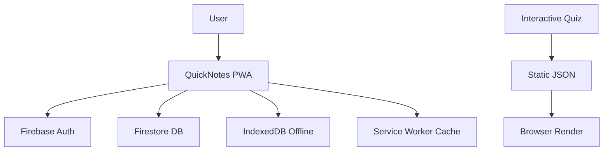

<div align="center">

# ⌘ Mini-Project

> A curated collection of playful experiments, quick tools, and idea-capture apps.

[](https://react.dev)
[](https://vitejs.dev)
[](https://firebase.google.com)
[](https://typescriptlang.org)
[]

---

## 🗂 What's Inside

| Project | Purpose | Live Link | Stack |
|---------|---------|-----------|-------|
| **QuickNotes** | Capture ideas during the day instantly | [Live →](https://quicknote-7c89b.web.app) | React · Vite · Firebase · PWA |
| **Interactive Quiz** | Click-click website for faster study | — | HTML · JSON · JS |

---

## ✨ Why These Exist

Every project here solves a small, real problem quickly.

- **QuickNotes** — ideas fade in seconds; this gives them a button and a home.
- **Interactive Quiz** — reading can become passive; this makes review an active decision.

They are not production systems with large teams. They are personal experiments in speed, clarity, and minimal friction.

---

## 🏗 Architecture Overview



---

## 🚀 How to Explore

```bash
# QuickNotes (full stack)
cd quicknotes
npm install
npm run dev         # localhost:3000
npm run deploy      # build + Firebase Hosting

# Interactive Quiz (static)
open interactivequiz/index.html
```

> **Note:** QuickNotes requires a `.env` file with Firebase config values (`VITE_FIREBASE_*`).

---

## 📦 Tech Stack at a Glance

| Layer | Technology |
|-------|------------|
| UI | React 19 · TypeScript |
| Styling | Tailwind CSS |
| Build | Vite |
| State | Zustand (persisted) |
| Database / Auth | Firebase Firestore & Auth |
| Search | MiniSearch |
| PWA | vite-plugin-pwa + Workbox |
| Icons | Lucide React |

---

## 🤝 Contributing

These are personal experiments. If you have ideas for new mini-projects — fast tools, study aids, quick capture apps — open an issue or submit a PR with a new folder. Keep it light, keep it fast.

---

## 🙏 Acknowledgments

Built with care, coffee, and the belief that a simple button can save a thought.

---

<!-- Feature Grid -->

### Key Features

- ⚡ **Big + Button** — create instantly
- ⌨️ **Shortcuts** — `Ctrl+N`, `Ctrl+K`, `Ctrl+S`
- 🌙 **Themes** — dark / light / system
- 📱 **PWA** — installable, offline-ready
- 🔍 **Search** — full-text indexing
- 🇻🇳 **Vietnamese origin** — ideas captured in passing
</div>
