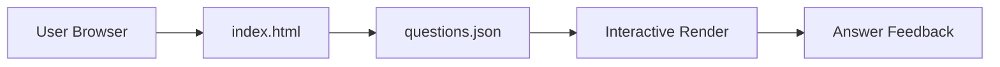

<div align="center">

# 🎯 Interactive Quiz

> A click-click study tool made for faster learning — built quickly, meant for quick use.

[](https://developer.mozilla.org/en-US/docs/Web/HTML)
[]()
[]()

```text
  ╔══════════════════════════════╗
  ║  Learning through interaction ║
  ╚══════════════════════════════╝
```

---

## 🧠 What It Is

A lightweight quiz site created during study sessions. Instead of reading static text passively, you answer questions interactively with immediate feedback. The goal is to turn review time into active recall.

---

## ✨ Features

| Feature | Description |
|---------|-------------|
| **Instant Load** | No server required; open `index.html` locally |
| **JSON-Driven** | Questions live in `questions.json`; easy to extend |
| **Immediate Feedback** | Answers respond without page reload |
| **Distraction-Free** | Minimal design, no decorative noise |
| **Static Export** | Works offline after download |

---

## 📁 Project Tree

```text
interactivequiz/
├── index.html            # Main site (renders quiz)
├── questions.json        # Question bank (structured data)
├── generate_site.py      # Build script
├── extract.py            # Data extraction from PDF sources
├── parse.py              # Parser utilities
└── VAIO_2026_...pdf      # Source material
```

---

## 🏗 Architecture



---

## 🚀 How To Use

```bash
# Just open the file
open interactivequiz/index.html

# Or serve locally
python -m http.server 8000
# Visit http://localhost:8000/interactivequiz/
```

---

## 📝 Why It Exists

When studying, passive reading can become automatic — eyes move, but retention stays low. This site forces a decision at every step: choose an answer, see the result, move on. That loop of action + feedback is what makes repetition stick.

---

> *Built quickly, meant for quick use.*

</div>
