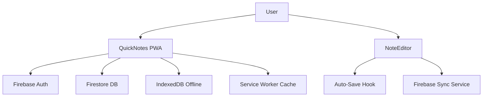

<div align="center">

[](https://quicknote-7c89b.web.app)

# 📝 QuickNotes

> Capture ideas during the day before they disappear.

```text
  ┌──────────────────────────────────────┐
  │  Dump thoughts. Organize fast.       │
  │  Sync everywhere.                    │
  └──────────────────────────────────────┘
```

---

## 🌐 Live Website

**[https://quicknote-7c89b.web.app](https://quicknote-7c89b.web.app)**

---

## ✨ Why This Exists

Ideas often arrive in brief windows — while walking, between conversations, or mid-task. Waiting to open a full productivity suite kills the moment. QuickNotes reduces that delay to near zero with a big button, keyboard shortcuts, and offline-first storage.

---

## 🛠 Feature Matrix

| Feature | What It Does | How To Access |
|---------|--------------|---------------|
| **New Note** | Creates a note instantly | Big `+` button or `Ctrl+N` |
| **Search** | Full-text across all notes | `Ctrl+K` |
| **Folders** | Organize into Inbox / Archive / Custom | Sidebar |
| **Auto-Save** | Saves after typing delay | Automatic |
| **Offline** | Works without internet | IndexedDB + Service Worker |
| **Sync** | Firestore when signed in | Background sync |
| **Export** | ZIP backup / import | Settings → Export |
| **Themes** | Dark / Light / System | Settings → Theme |
| **PWA** | Installable app experience | Browser install prompt |

---

## 🏗 Architecture



---

## 📂 Project Tree

```text
quicknotes/
├── src/
│   ├── App.tsx              # Root layout + routing
│   ├── components/          # NoteList, NoteEditor, Sidebar, UI
│   ├── stores/              # Zustand app state
│   ├── services/            # Firebase sync logic
│   └── hooks/               # Auto-save, keyboard, theme
├── public/
│   ├── sw.js                # Service worker
│   └── manifest.webmanifest # PWA manifest
├── firebase.json            # Hosting + Firestore config
├── firestore.rules          # Security rules
└── vite.config.ts           # PWA plugin + build config
```

---

## 🚀 How To Explore

```bash
# QuickNotes
cd quicknotes
npm install
npm run dev         # localhost:3000
npm run build       # production dist/
npm run deploy      # build + Firebase deploy

# Requires .env with VITE_FIREBASE_* values
```

---

## 🔑 Key Design Decisions

- **No backend server** — Firebase handles auth, DB, and hosting; the frontend is fully static
- **Offline first** — IndexedDB stores notes locally; sync happens when online and authenticated
- **Keyboard-driven** — shortcuts reduce mouse dependency for power users
- **Minimal UI** — no decorative clutter; information and speed take priority

---

> *Not every idea needs a long document. Sometimes it just needs a quick button, a clean input, and a place to land.*

</div>
